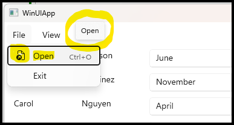
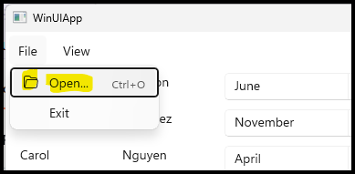

## WinRT and XAML Commands ##

### The Problem with Click Handlers ###

In [a previous entry]() we discussed Click Handlers in the context of setting up menu actions. The basic workflow was to create a function in our `MainWindow.xaml.cpp` file and bind it to the relevant XAML object in `MainWindow.xaml` using the `Click=` attribute. The Click Handler can either be standard synchronous functions for quick actions that won't impede the main UI thread or `winrt::fire_and_forget` coroutine functions that suspend and return to the main thread until they perform some action in the background and are then resumed. Pretty standard fare and easy to grok. Very similar to writing callback functions in good 'ol Win32.

So what's the problem then? 

Well, one problem is you end up with a bunch of functions tightly integrated into your main window class. You can't really use them with other windows or objects without re-writing them and your window class can become bloated with functions that it would be nice to place elsewhere for maintenance.

Perhaps a more challenging issue with Click Handlers is how to *disable* a menu command (ie, grey it out on the menu) when its action is not possible to complete. For example, disabling `Save` on the menu until changes are made in a file. With standard Click Handlers, you have to manually update the XAML object whenever state changes to change the appearance and disable the click functionality.

Wouldn't it be great if we could create independent objects that perform actions and can be linked to XAML objects? Not only that, but could even hold properties like icons, labels, keyboard shortcuts, availability indicators, and descriptions. Say hello to my little friend, **XAML Commands**!

[Documentation Here](https://learn.microsoft.com/en-us/windows/apps/develop/ui/controls/commanding)

## Command Basics ##

XAML Commands come in three flavors, from pre-defined to completely customizable. Each class derives from its more basic parent class:

- StandardUICommand: Preconfigured to support several basic system commands
- XamlUICommand: Provides preset customizable functions to create custom commands
- ICommand: Completely customizable base Command class

### StandardUICommand ###

We'll start off with the `StandardUICommand` as it offers built-in functionality for most basic system functions, including labels, icons, and keyboard shortcuts:

>**Note** (2026-11-04)
>
>The following table is from the [Documentation](https://learn.microsoft.com/en-us/windows/windows-app-sdk/api/winrt/microsoft.ui.xaml.input.standarduicommand?view=windows-app-sdk-2.0#remarks) but seems to be inaccurate (eg, Open, Close, Paste)

| Command/Label | Description | Icon | Keyboard shortcut |
| --- | --- | --- | --- |
| Cut | Delete the selected content and copy it to the clipboard. | E8C6 | Ctrl + X |
| Copy | Copy the selected content to the clipboard. | E8C8 | Ctrl + C |
| Paste | Insert the clipboard content. | E77F | Ctrl + P |
| Select All | Select all content. | E8B3 | Ctrl + A |
| Delete | Delete the selected content. | E74D | Delete |
| Share | Share the selected content. | E72D | n/a |
| Save | Save changes. | E74E | Ctrl + S |
| Open | Open panel. | E8A0 | Ctrl + O |
| Close | Close panel. | E89F | Alt + F4 |
| Pause | Pause currently playing media. | E769 | Spacebar |
| Play | Play currently paused media. | E768 | Spacebar |
| Stop | Stop media. | E71A | Escape |
| Forward | Skip forward. | E72A | Alt + Right arrow |
| Back | Skip back. | E72B | Alt + Left arrow |
| Undo | Revert the most recent action. | E7A7 | Ctrl + Z |
| Redo | Repeat the most recently undone action. | E7A6 | Ctrl + Y |

See that big shiny **Open** Command? That's what we'll use in our project to replace our current Click Handler! 

>**Note**
>
>Before we continue, I just wanted to point out that our test application is really basic, so implementing a XAML Command might be a bit overkill when our Click Handler is working just fine. The [Documentation](https://learn.microsoft.com/en-us/windows/apps/develop/ui/controls/commanding#command-experiences-using-the-icommand-interface) even says we might be fine with just the Click Handler and a bound variable to update the Open menu item `IsEnabled` attribute.
>
>Since we never updated the `IsEnabled` attribute on the Open menu item when executing the Click Handler, we technically have a bug. While the `FileOpenPicker` window is modal and will prevent input on the parent `MainWindow` while open, once the coroutine suspends and the background file load process initiates, there might be a millisecond or two when another Open request could be submitted. 
>
>So we accidentally set ourselves up with an excuse to implement the XAML Open Command because it will give us an easy way to take care of all that while teaching us the "best" way to do things.

Let's start off by updating our `MainWindow.xaml` file:

**`MainWindow.xaml`**
```xaml
<?xml version="1.0" encoding="utf-8"?>
<Window
   ...
    <Grid>
        <Grid.Resources>
            <StandardUICommand
               x:Name="OpenCommand"
               Kind="Open"
               ExecuteRequested="OnOpenExecuteRequested"
               AccessKey="O" />
        </Grid.Resources>
        ...
        <MenuBar Grid.Row="0">
            <MenuBarItem Title="File" AccessKey="F" >
                <MenuFlyoutItem Command="{StaticResource OpenCommand}" />                
                <MenuFlyoutItem Text="Exit" Click="OnExitClick" AccessKey="X"/>
            </MenuBarItem>
            ...
        </MenuBar>
        ...
    </Grid>
</Window>
```

To use the `StandardUICommand`, we first added it to the `Grid`'s local `Resources`. We set its `x:Name` and `Kind` attributes followed by the `ExecuteRequested` function name attribute. We can also put an `AccessKey` here so we don't have to set it on every `MenuFlyoutItem`. Remember, setting `x:Name="OpenCommand"` gives us a way to access this object by name in our cpp code using something like 
```c++
auto c = OpenCommand();
```

Once defined as a resource, it can be used by name within the `Grid` so we use it in the Open `MenuFlyoutItem`. Notice how we were able to remove the `Text=`, `Click=`, and `AccessKey=` attributes and even the entire `KeyboardAccelerator` section - all these will now be set from `OpenCommand`. 

It’s still possible to override what `OpenCommand` provides. If we wanted a label other than the default "Open" we could set `Text=` on the `MenuFlyoutItem` to change it just for that item, or set `Label=` on the `StandardUICommand` itself to change it everywhere the command is used.

We still need to create our `OnOpenExecuteRequested()` function in cpp to match the `ExecuteRequested` attribute. The logic will stay exactly the same but the function signature will change to handle a `XamlUICommand` input parameter:

**`MainWindow.xaml.h`**
```c++
...
#include <winrt/Microsoft.UI.Xaml.Input.h>  // For XamlUICommand, ExecuteRequestedEventArgs
...
namespace winrt::WinUIApp::implementation
{
   struct MainWindow : MainWindowT<MainWindow>
   {
   ...
   // Command ExecuteRequested Handlers
   winrt::fire_and_forget OnOpenExecuteRequested(
    winrt::Microsoft::UI::Xaml::Input::XamlUICommand const& sender,  
    winrt::Microsoft::UI::Xaml::Input::ExecuteRequestedEventArgs const& args);
   
   // Click handlers
   void OnExitClick(IInspectable const& sender, RoutedEventArgs const& e);
   void OnOrientationClick(IInspectable const& sender, RoutedEventArgs const& e);
   void OnSizeClick(IInspectable const& sender, RoutedEventArgs const& e);
   ...
   }
}
...
```

**`MainWindow.xaml.cpp`**
```c++
...
   namespace winrt::WinUIApp::implementation
   {
       winrt::fire_and_forget MainWindow::OnOpenExecuteRequested(
           [[maybe_unused]] winrt::Microsoft::UI::Xaml::Input::XamlUICommand const& sender, 
           [[maybe_unused]] winrt::Microsoft::UI::Xaml::Input::ExecuteRequestedEventArgs const& args)
       {
       ...   // Same code as original OnOpenClick()
       }
   ...
   }
...
```

Recompile and you should have the same behavior as before but with some minor cosmetic differences
- The menu will say "Open" and not "Open..." like before
- The menu will have a cheesy icon that I've never seen in Windows for "Open" before
- A popup with the command name will appear on hover



### Modifying a StandardUICommand ###

Let's fix that nasty looking icon, get rid of that popup (a menu popup? really?), and revert the text to the old "Open..."

**`MainWindow.xaml`**
```xaml
...
   <Grid.Resources>
      <StandardUICommand
         Label="Open..."
         x:Name="OpenCommand" 
         Kind="Open" 
         ExecuteRequested="OnOpenExecuteRequested">
         <StandardUICommand.IconSource>
            <FontIconSource Glyph="&#xED25;"/>
         </StandardUICommand.IconSource>
      </StandardUICommand>
   </Grid.Resources>
   ...
   <MenuFlyoutItem Command="{StaticResource OpenCommand}"
      AccessKey="O"
      ToolTipService.ToolTip="{x:Null}"/>
   ...
```

We re-define the `Label=` attribute, set the tooltip to `x:Null`, and set up a new icon.

Icons can be defined as XAML elements and be referenced in a [few different ways](https://learn.microsoft.com/en-us/windows/apps/develop/ui/controls/icons): 
- From a bitmap using [`BitmapIcon`](https://learn.microsoft.com/en-us/windows/windows-app-sdk/api/winrt/microsoft.ui.xaml.controls.bitmapicon)
- From an image using [`ImageIcon`](https://learn.microsoft.com/en-us/windows/windows-app-sdk/api/winrt/microsoft.ui.xaml.controls.imageicon)
- From a defined vector graphic using [`PathIcon`](https://learn.microsoft.com/en-us/windows/windows-app-sdk/api/winrt/microsoft.ui.xaml.controls.pathicon)
- From a font using [`FontIcon`](https://learn.microsoft.com/en-us/windows/windows-app-sdk/api/winrt/microsoft.ui.xaml.controls.fonticon) and a `Glyph` number plus optional `FontFamily`
   - Default font: [Segoe Fluent](https://learn.microsoft.com/en-us/windows/apps/design/iconography/segoe-fluent-icons-font) (Win11) or [MDL2 Assets](https://learn.microsoft.com/en-us/windows/apps/design/iconography/segoe-ui-symbol-font) (Win10)
- By symbolic name from the Segoe MDL2 font using [`SymbolIcon`](https://learn.microsoft.com/en-us/windows/windows-app-sdk/api/winrt/microsoft.ui.xaml.controls.symbolicon)

The icon definitions above are meant for creating icons directly in the XAML layout. Each of the types above has an alternative `xxxxxxSource` version that lets you create a **shareable** icon resource. This resource can be placed in a resource dictionary and then referred to by its assigned key value or, as we assign it to our `OpenCommand`, be shared with any object that uses that command. 

When creating our `FontIconSource` we have to use the glyph number which is kind of unfortunate. The font family used depends on which version of Windows we're running but both families share the same glyph numbers. Some weirdness like `e838` "Folder Open" is horizontal in one and vertical in another. We use glyph `ed25` "Open Folder Horizontal" to ensure a uniform look.

`&#xED25;` is an XML character reference, a way of writing a Unicode character by its number:

- `&#` starts a numeric character reference.
- `x` means the number is hexadecimal.
- `ED25` is the character's Unicode code point, the part the font documentation lists.
- `;` ends the reference.

The XAML parser replaces the whole thing with the single character U+ED25. If you ever set it from cpp, the equivalent is `L"\uED25"`.

We could use a `SymbolIconSource` and reference by symbol *name* but we'd be limited to the subset of the Segoe MDL2 font that has been enumerated and that collection didn't really have a nice open folder like I wanted. The enumerated values are [documented here](https://learn.microsoft.com/en-us/windows/windows-app-sdk/api/winrt/microsoft.ui.xaml.controls.symbol).



Aaaaaah. That's better! 

### XamlUICommand ###

You may be wondering, if we're going to modify so much of the "Standard" command, why not just start with a custom command? Well, good question!

Let's see how we would set up the same command but as a `XamlUICommand` instead. This version of a XAML command provides a skeleton upon which we build out our custom command.

All we have to do is change our XAML code. Both command types use the same `ExecuteRequested` function signature so no cpp changes. Remember, `StandardUICommand` is really just a `XamlUICommand` with  defaults already filled out, so the difference is we have to explicitly provide all the command settings in XAML. We lose the `Kind=` attribute because `XamlUICommand` doesn't have defaults. We do have to define a `KeyboardAccelerator` but the good news is there's no default `Tooltip` defined so no stupid popup on the menu!

**`MainWindow.xaml`**
```xaml
...
   <Grid.Resources>
      <XamlUICommand 
          Label="Open..."
          x:Name="OpenCommand"                 
          ExecuteRequested="OnOpenExecuteRequested"
          AccessKey="O">
          <XamlUICommand.IconSource>
              <FontIconSource Glyph="&#xED25;"/>
          </XamlUICommand.IconSource>
          <XamlUICommand.KeyboardAccelerators>
              <KeyboardAccelerator Modifiers="Control" Key="O"/>
          </XamlUICommand.KeyboardAccelerators>
      </XamlUICommand>
   </Grid.Resources>
   ...
```


2. ICommand Basics
   What Execute, CanExecute, and CanExecuteChanged do, using
   Microsoft::UI::Xaml::Input (not the UWP Windows::UI::Xaml namespace).

3. Built-in Options: XamlUICommand and StandardUICommand
   Bundling label, icon, accelerator, and description; handling
   ExecuteRequested / CanExecuteRequested; using predefined commands
   like Cut, Copy, and Delete for menus.

4. Rolling Your Own: A Reusable DelegateCommand
   C++/WinRT has no RelayCommand equivalent, so build one with
   winrt::implements<..., ICommand> that wraps lambdas.

5. Wiring It Up: IDL, Binding, and Parameters
   Declaring the command property in .idl, binding with {x:Bind MyCommand},
   and unpacking CommandParameter from IInspectable with unbox_value / try_as.

6. Keeping UI State in Sync
   Raising CanExecuteChanged (or calling NotifyCanExecuteChanged) so menu
   items and buttons enable and disable correctly.
